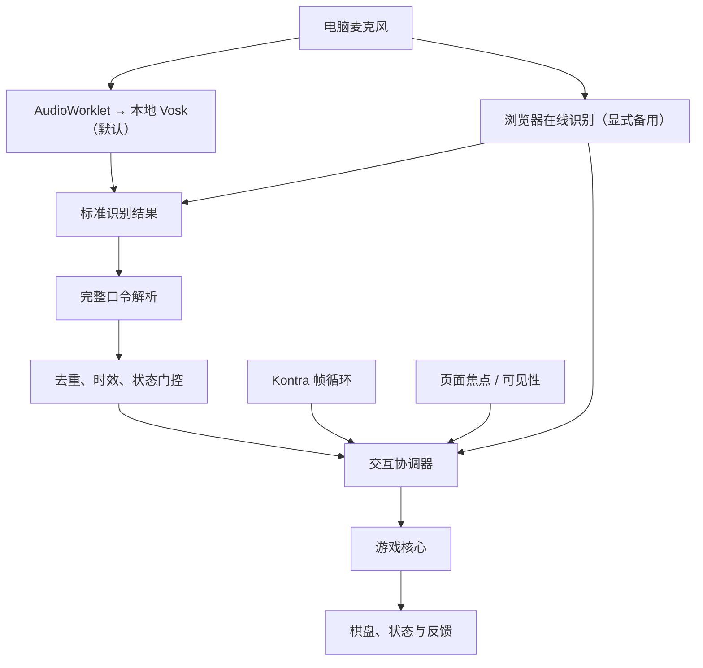
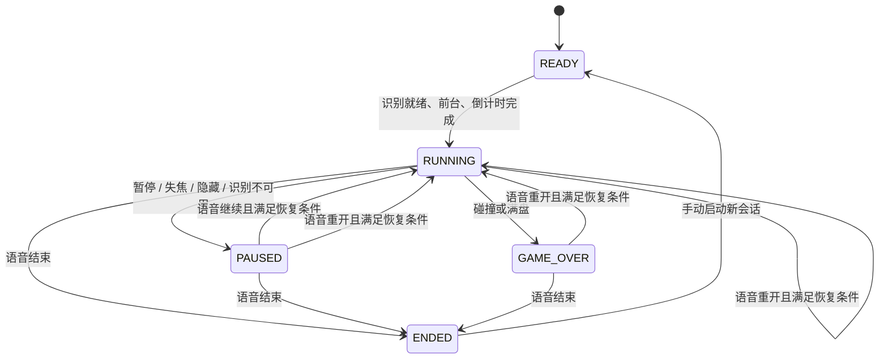
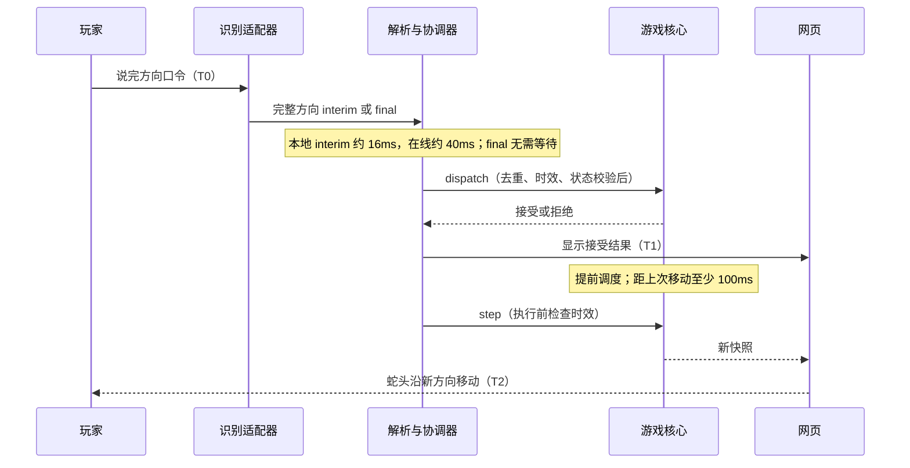

# 架构设计

更新日期：2026-10-25。本文描述当前实现。Mermaid 图源可直接编辑，并在支持 Mermaid 的 Markdown 阅读器中渲染。

## 系统边界

网页运行游戏核心、展示棋盘并处理交互状态。识别适配器提供标准文本结果，游戏逻辑不依赖特定语音厂商。



当前首页已连接游戏核心与 Canvas 棋盘。普通入口默认本地识别，可在启动前显式选择浏览器在线备用；`?debug=1` 接收文本模拟，三者共用指令门控与游戏规则。Kontra 调用更新与渲染，GameSession 控制 500ms 巡航步进、提前转向及前台/语音条件。

## 模块规格与分工

| 模块 | 输入与输出 | 职责 | 状态 | 负责人 |
| --- | --- | --- | --- | --- |
| 识别适配器 | 麦克风 → VoiceInput、状态、错误 | 本地音频采集与识别、在线备用、生命周期与故障处理 | 两种适配已实现，合成音频及四环境真实语音验收通过；分模式记录待归档 | 朱晶 |
| 指令解析 | 文本 → Command/null | 完整匹配、别名、空白和句末标点处理 | 已实现 | 朱晶 |
| 指令门控 | CommandEvent、状态、时钟 → Receipt | 去重、输入时效和状态合法性 | 已实现，执行前复检已集成 | 朱晶 |
| 交互协调器 | 识别/焦点事件 → 游戏调用、反馈 | 启动条件、异常暂停、恢复前置条件 | 已实现，自动测试使用模拟识别事件 | 朱晶 |
| 游戏核心 | 命令、tick、随机源 → GameSnapshot | 移动、碰撞预测、增长、计分和结算 | 已实现，18 项规则测试通过 | 朱晶 |
| 网页与反馈 | 快照、识别状态 → 画面与音效 | 棋盘、分数、接受/执行结果 | 已实现，浏览器模拟 ASR 检查通过 | 朱晶 |
| 验证材料 | 测试样本、实机结果 → 测试报告 | 用例、环境矩阵、结果与演示素材 | 四环境验收通过，环境与量化记录待归档 | 王任 |
| 验收录屏 | 棋盘、麦克风、命令事件 → WebM/JSON | 显式开启、合成标注、内存暂存与手动下载；不控制游戏 | 已实现，模拟音频验证；正式真人 Demo 待录制 | 朱晶 |

## 已实现的输入契约

以下为现有 JavaScript 模块的类型化说明，非独立 TypeScript 源文件。

```ts
type Direction = 'UP' | 'DOWN' | 'LEFT' | 'RIGHT';
type Command = Direction | 'PAUSE' | 'RESUME' | 'RESTART' | 'END';
type GameState = 'READY' | 'RUNNING' | 'PAUSED' | 'GAME_OVER' | 'ENDED';
type VoiceInput = {
  text: string;
  resultId: string;   // 识别会话前缀 + 结果索引
  receivedAt: number; // performance.now()，表示回调到达时间
  isFinal: boolean;
  source?: 'local'; // 本地适配器标记，用于选择较短的方向稳定窗口
};
type CommandEvent = { command: Command; id: string; receivedAt: number };
type Receipt = { accepted: boolean; reason: string };
```

`src/commands.mjs` 提供 `parseCommand(text)` 和 `createCommandGate({ttlMs, capacity})`；门控的 `accept(event, state, now)` 返回 Receipt。默认 TTL 为 1500ms，去重记录上限 256 条。

`src/browser-voice.mjs` 提供 `BrowserVoice`，通过 `start()`、`stop()` 管理识别，回调为 `onStatus`、`onText`、`onFailure`。方向可使用稳定的中间结果，状态命令仅使用 final；识别器删除中间结果时，以同 ID 的空文本通知协调器取消候选。启动等待上限 15 秒；意外结束后停止，由界面发起恢复，不自动循环重试。

去重以结果 ID 为单位，缓存超过上限后淘汰旧记录，不提供无限期去重。TTL 只衡量回调到达后的时间，不包含语音服务内部耗时。

## 游戏核心接口

游戏核心不直接访问 DOM、麦克风或浏览器计时器，调度与识别就绪检查由协调器负责。

```ts
type Point = { x: number; y: number };
type GameResult = {
  outcome: 'WIN' | 'LOSS' | 'ABORTED';
  reason: 'board_full' | 'wall' | 'self' | 'manual_end';
} | null;
type GameSnapshot = {
  roundId: number;
  state: GameState;
  cols: number;
  rows: number;
  snake: Point[];             // 蛇头在前
  direction: Direction;
  pendingDirection: Direction | null;
  food: Point | null;         // 满盘时为 null
  score: number;
  tick: number;
  result: GameResult;
  pauseReason: string | null;
  lastAppliedId: string | null;
  lastDiscardedId: string | null;
};
interface GameEngine {
  prepare(): GameSnapshot;
  start(): GameSnapshot;
  dispatch(event: CommandEvent, now: number): Receipt;
  step(now: number): GameSnapshot;
  pause(reason: 'manual' | 'focus' | 'hidden' | 'voice_unavailable'): GameSnapshot;
  snapshot(): GameSnapshot;
}
```

`src/game.mjs` 的引擎构造时注入棋盘配置和随机源，也支持初始蛇身、方向与食物供规则测试使用。`prepare()` 将 ENDED 转到 READY 以重新倒计时，`start()` 用于新会话；RESTART 通过 `dispatch` 创建新一局，清空分数、结果和待执行方向，增加 roundId。`snapshot()` 返回与内部状态隔离的副本。`step()` 仅在 RUNNING 前进一步，其他状态不移动，也不累计补走步数。

状态命令即时生效；方向在 dispatch 时检查反向及当前步进容量，合法方向进入 pendingDirection。协调器将下一步提前到下一更新帧或距上一步满 100ms 时，执行后从实际移动时间重新计算 500ms 巡航周期。accepted 表示已接收，不等于已在画面转向。同向口令不触发额外步进；已有待转向时拒绝后续方向口令为 `turn_pending`，反向口令返回 `opposite_direction`。

边缘容错由协调器负责，不改变核心 step 的碰撞规则。步进到期且 `nextStepHitsWall(now)` 为真时，建立一次 1200ms 的绝对期限，暂不调用 step，蛇头停在边界且状态仍为 RUNNING。预测使用执行时仍有效的 pending 方向，与 step 的 TTL 和轮次校验保持一致。合法转向将下一步提前，成功避开边界后清空期限；同向、无效或转向另一面墙不重置期限。到期仍将撞墙则按核心规则结算；自撞不触发缓冲。暂停、失焦、结束及重开清空缓冲。`wallGraceMs: 0` 可禁用，默认语音模式启用。快照的 `wallWaitMs` 仅用于倒计时和边框反馈，不表示识别耗时，也不作为降低延迟的证据。

协调器只在命令入口做结果 ID 去重；执行 step 前单独检查待转向时效及所属轮次，不再次调用去重门控。过期转向丢弃并反馈，继续沿原方向移动。暂停、重开、失焦、识别断开及结算均清空待执行转向；当前识别会话的去重记录跨局保留。

`src/session.mjs` 的 GameSession 通过 `requestStart`、`setListening`、`setPresence`、`receive`、`update` 协调外部事件，并回调 `onChange` 和 `onReceipt`。中断与重开时，尚在生成中间结果的结果 ID 进入有界失效集合，避免后续 final 结果跨交互执行。若服务在中断后才首次上报旧语音，且没有音频时间戳，适配器无法可靠判定其实际发声时间，此限制仍需真实服务验证。

低延迟方向路径：本地完整方向 interim 保存约 16ms 稳定窗口，在线备用约 40ms；由适配器的 `source: 'local'` 标记区分。同义更新不重置窗口，方向变化重新计时，非口令或撤回取消候选。窗口到期仍走原有门控与 dispatch，并提前调度 step；final 先到则直接处理。提前尝试过的 ID 在有界集合中去重，后续修订及 final 不再派发，也不覆盖已转向反馈；中断清空候选。提前接收后若被修订为否定句或其他方向，动作不撤销；缩短窗口进一步压低等待，也减少修订取消机会，需真实语音评估误触率。

`src/local-voice.mjs` 通过 Vosk Worker 识别，AudioWorklet 在 16kHz 下每 256 个采样（16ms）发送单声道音频。采集请求启用回声消除、降噪及自动增益；是否实际启用取决于设备和浏览器。识别采用游戏口令词表，包含否定、歧义和未知词路径，不将任意识别文本模糊映射为方向。音量超过 RMS 0.008 后累计约 128ms 安静即请求 final；这不是独立训练的 VAD，噪声、轻声及慢速口令中间停顿可能影响断句。stop 释放采集节点、轨道、识别器和 AudioContext，模型保留以便重连复用。音频上下文中断或设备轨道结束时暂停游戏并报告错误。

`tools/voice-profile.cjs` 生成 `fast-v1` 模型配置，将 `frames-per-chunk` 设为 6，保持原有声学权重、beam、词表及 endpoint 配置不变。它减少内部解码批量，而非仅提高送入音频的频率；较小批量也可能增加调度或计算开销。`setup:voice` 将配置写入模型归档，适配器从独立的 `/models/chinese-fast-v1.tar.gz` 加载，避免命中旧归档的 IndexedDB 缓存；不依赖浏览器强制清缓存。此优化的有限合成音频对比见测试报告，仍不保证不同硬件上的实时效果。

移动碰撞以更新后的占用情况计算：未吃食物时尾格本步会腾空，可进入旧尾格；吃到食物时保留尾格。食物仅从空格中生成，满盘直接 WIN。碰撞为 LOSS；主动结束未结算的一局为 ABORTED，结算后结束会话保留已有胜负结果。

## 状态转换



恢复条件为识别监听已就绪、页面可见且有焦点。焦点或连接恢复本身不改变 PAUSED。权限故障需要手动恢复时，本次流程归类为异常恢复。READY 倒计时被失焦、隐藏或识别中断取消，恢复后重新满足启动条件才重新计时。

## 转向时序与延迟



指令确认延迟为 T1−T0，实际转向延迟为 T2−T0。暂停等状态命令即时处理，不等待移动周期。

初始 500ms/格方案的参考预算如下，均为设计预算而非实测：

| 环节 | 参考预算 |
| --- | --- |
| 语音结束到首次可用方向结果 | 依实际识别服务测量，不假定 200ms |
| 中间结果稳定窗口 | 本地约 16ms，在线约 40ms，加调度误差；final 跳过 |
| 解析、门控和派发 | 20ms |
| 等待执行 | 下一更新帧；刚发生移动时，最多等待剩余的 100ms 最短步间隔 |
| 画面更新 | 30ms |

提前接收可跳过最终断句等待，但首次结果到达仍受音频、解码和设备性能影响。页面的“识别结果 → 转向”仅统计可用回调到实际 step 的耗时，包含稳定窗口，不是 T2−T0；拒绝的命令不生成新耗时。前台卡顿时可超出上述预算，仍不补走多步。最终以真实音频录屏的 T0/T1/T2 验收，不以分项预算代替端到端实测。

## 识别与部署

当前默认 Vosk 0.0.8 搭配中文 small-cn 0.22 模型，在浏览器本地运行；浏览器 SpeechRecognition/webkitSpeechRecognition（zh-CN）作为显式备用。模型准备步骤、固定版本及许可证见 README，模型以独立下载产物分发，不提交大型二进制。最终支持范围仍依据四个目标环境的真实语音可用性、正确率及延迟确定。

当前为原生 ES 模块，无编译步骤。运行前通过 npm 安装固定版本依赖，具体复用见 README。Kontra 负责帧循环，网格规则和语音调度由本项目模块负责。静态开发服务仅监听回环地址；外部部署使用 HTTPS。资源路径相对部署目录解析；交付工具将路由白名单导出为静态站点，并打包包含依赖和模型的离线运行包。需保密凭证的识别服务由后端或短期凭证接入。普通入口不持久化语音和诊断日志；验收录屏仅经主动操作在内存生成，由用户下载。录屏停止只释放自有视频轨道，不停止游戏拥有的麦克风；结束游戏、通道停止或离开页面时同时结束录制。测试证据按测试报告中的授权与脱敏要求保存。
