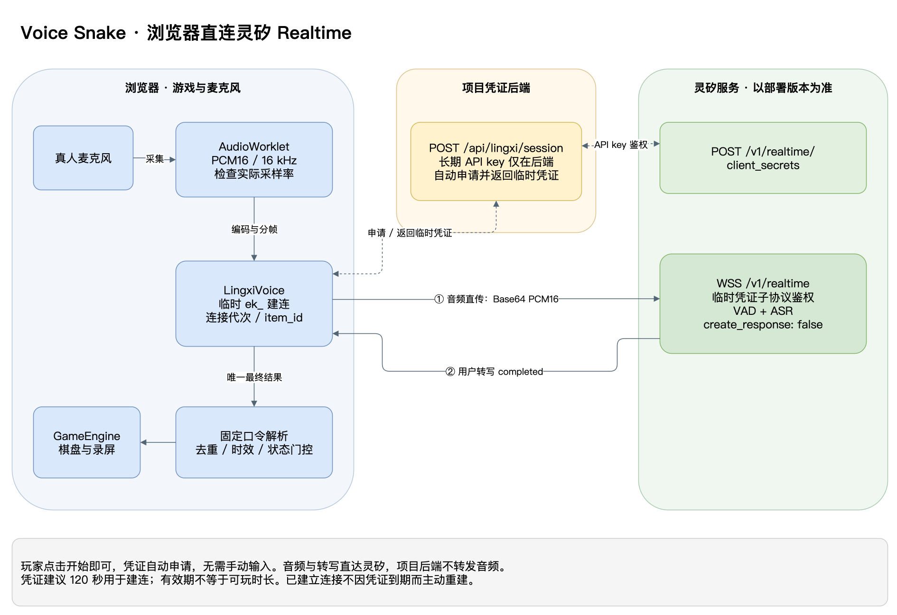

# 灵矽 Realtime 直连接入设计

日期：2026-10-25，Asia/Shanghai。状态：设计稿（待评审、未实施）。本文件描述目标方案，不代表已接入灵矽或已完成线上验证。当前实现仍以 [README](../README.md) 和 [架构设计](architecture.md) 为准。

## 1. 决策与范围

采用“浏览器直连灵矽 Realtime WebSocket + 项目后端签发临时凭证”的方式。麦克风音频从浏览器直接上传灵矽，由灵矽 VAD/ASR 返回用户转写，交给现有固定口令解析与游戏状态机执行动作。

长期 API key 仅存在于项目后端，用于向灵矽申请短期 `ek_` 凭证。浏览器取得临时凭证后直接连接灵矽；玩家无需输入任何凭证。项目后端不转发音频，也不运行语音模型。浏览器仍需对自己的 WebSocket、麦克风和游戏状态负责。

协议字段、鉴权和事件时序以灵矽原生 Realtime 实现为依据，接入能力以目标部署实际回显及联调结果为准。

首版选择浏览器直连 WSS：现有项目已有 AudioWorklet，音频到转写的单向任务不需要引入 WebRTC SDP/ICE/UDP 部署。若以后实测证明 WSS 传输是主要瓶颈，再单独评估灵矽原生 WebRTC，不能仅凭 WebRTC 名称承诺更低端延迟。

首版关闭自动回复，不让 LLM 决定上下左右，不通过助手字幕或工具调用执行转向。真实灵矽语音链路与本地确定性游戏规则可以同时成立；是否还需展示指定 Agent、模型或其他平台能力，属于活动验收口径，需要事实确认。

## 2. 分析依据与关键发现

本方案基于以下固定源码版本进行协议核对：

| 仓库 | 参考提交 | 用途 |
| --- | --- | --- |
| voice-snake | `c47902c6b2b675b20b95478d0f4aae3b185ab479` | 当前游戏、语音适配、会话及录屏边界 |
| qbox/xrobotd | `9a6f7cdf3c5ed32a6905afa60e68ff14cfcd4737` | 灵矽原生 Realtime 协议与服务端行为的主要依据 |

外部源码链接固定到上述提交，可能需要对应仓库访问权限。目标部署版本、地址和可用能力仍需实测确认。

最新项目文档已记录朱晶确认原有识别方案的四环境真人验收通过，但环境与量化记录待归档；并已删除“灵矽仅为名称”的表述。已有结论不能直接计作新增灵矽 Realtime 链路验收，接入后须独立回归。

| 已核实事实 | 对设计的影响 | 依据 |
| --- | --- | --- |
| 原生 Realtime 提供 `/v1/realtime` 和 `/v1/realtime/client_secrets` | 浏览器使用前者连接，后端用后者签发临时凭证；不从设备地址推导公网 Realtime 地址 | [realtime_handler.go](https://github.com/qbox/xrobotd/blob/9a6f7cdf3c5ed32a6905afa60e68ff14cfcd4737/linxdv0/internal/server/realtime_handler.go#L29) |
| 浏览器 WebSocket 子协议槽只接受 `ek_` 临时凭证；签发接口由长期 API key 鉴权 | 后端保管长期 key，浏览器连接时使用短期凭证 | [realtime_auth.go](https://github.com/qbox/xrobotd/blob/9a6f7cdf3c5ed32a6905afa60e68ff14cfcd4737/linxdv0/internal/server/realtime_auth.go#L147) |
| `session.type = transcription` 被拒绝 | 必须建 `realtime` 会话，再开启输入转写并关闭自动回复 | [codec.go](https://github.com/qbox/xrobotd/blob/9a6f7cdf3c5ed32a6905afa60e68ff14cfcd4737/linxdv0/internal/realtime/wire/codec.go#L337) |
| `transcription: {}` 开启转写事件；`create_response: false` 阻止自动生成回复 | 可直接使用用户转写控制游戏，无需 LLM/TTS 输出参与 | [input.go](https://github.com/qbox/xrobotd/blob/9a6f7cdf3c5ed32a6905afa60e68ff14cfcd4737/linxdv0/internal/realtime/input.go#L476) |
| 当前 `delta` 和 `completed` 均在 `settleTurn` 整句收束时发送 | `delta` 不是可承诺的流式 partial；首版只按 completed 执行 | [input.go](https://github.com/qbox/xrobotd/blob/9a6f7cdf3c5ed32a6905afa60e68ff14cfcd4737/linxdv0/internal/realtime/input.go#L721) |
| 当前原生 PCM 接受 16 kHz 或 24 kHz；引擎内部为 16 kHz | 首选 16 kHz mono PCM16，须核对实际回显和部署版本 | [session_state.go](https://github.com/qbox/xrobotd/blob/9a6f7cdf3c5ed32a6905afa60e68ff14cfcd4737/linxdv0/internal/realtime/session_state.go#L185) |
| server_vad 默认静音窗口为 500ms；显式 0 仍回到默认值 | 不直接沿用默认值来宣称满足游戏 250ms 目标，也不将 0 当作零等待 | [session.go](https://github.com/qbox/xrobotd/blob/9a6f7cdf3c5ed32a6905afa60e68ff14cfcd4737/linxdv0/internal/realtime/wire/session.go#L500) |
| model 名称通过部署配置映射；Agent 由服务端默认配置选择 | 仅使用部署已配置的原生 model 别名；Agent 由服务端配置选择 | [realtime_handler.go](https://github.com/qbox/xrobotd/blob/9a6f7cdf3c5ed32a6905afa60e68ff14cfcd4737/linxdv0/internal/server/realtime_handler.go#L452) |
| 当前录屏入口绑定 LocalVoice，录屏器拒绝非 local 引擎 | 只加识别适配器还不够，必须一起改录屏流来源与引擎校验 | [session-recorder.mjs](../web/session-recorder.mjs) |

用户提供的 [平台入口](https://linx.qiniu.com/docs/xrobot/platform/) 实际为设备接入目录；它不能作为 Realtime 的字段契约。Realtime 以当前 xrobotd 实现和随仓库的[浏览器调试台说明](https://github.com/qbox/xrobotd/blob/9a6f7cdf3c5ed32a6905afa60e68ff14cfcd4737/linxdv0/test/realtime/README.md)为依据。源码可用不等于同版本能力已部署到公网。

## 3. 接入架构与鉴权



[可编辑架构图](diagrams/lingxi-realtime.drawio)。实线为实时音频、转写和游戏命令，虚线为临时凭证请求与返回。

建议新增项目 `POST /api/lingxi/session`。这是项目自己的凭证签发接口，不是灵矽现有端点；它只返回本次连接所需的临时接入信息。每个玩家持有自己的浏览器连接，不共享音频、转写或游戏会话。

1. 后端从环境或密钥管理加载 `LINGXI_API_KEY`、`LINGXI_API_BASE`、`LINGXI_REALTIME_URL` 和可选 `LINGXI_MODEL`。HTTPS API base 用于凭证签发，完整 WSS 地址用于浏览器连接，模型名只使用部署支持的原生别名。浏览器不能提交任意上游地址、模型或长期 key。
2. 浏览器在开始游戏时向项目后端请求临时凭证。公网凭证接口须有访问认证与限流；本机演示仅绑定回环地址并校验 Origin。玩家不需要输入凭证。
3. 后端以 `Authorization: Bearer <LINGXI_API_KEY>` 调用灵矽 `POST /v1/realtime/client_secrets`，申请 `ek_` 临时凭证。可以把受控的 Realtime 会话配置随签发请求一并提交，避免默认配置在连接初期产生不希望的行为；后续仍要核对实际生效配置。
4. 后端只返回受控 WSS URL、临时凭证及实际到期时间等必要字段，设置 `Cache-Control: no-store`；不返回长期 key 或原始上游错误。浏览器仅在内存中持有临时凭证，使用 `realtime` 和 `openai-insecure-api-key.<ek_值>` 子协议直接建立灵矽 WebSocket。
5. 收到灵矽 `session.created` 后，浏览器发送一次受控 `session.update`；收到并核对 `session.updated` 后才开始音频上行与游戏。音频、输入事件、转写事件均不经过项目后端。

签发失败（API key 无效、配额/并发限制、超时）与浏览器 WSS 连接失败需要分别提示。WebSocket 已连接不等于语音识别就绪；只有 `session.updated` 核对通过后才可进入倒计时。

现有 Node 服务可以扩展受控的凭证签发接口，不需要项目 WebSocket 服务端或音频转发依赖。浏览器直接使用原生 WebSocket 客户端连接灵矽。

本机演示可沿用回环地址静态服务并增加凭证接口；公网优先同一 HTTPS 域名托管页面和凭证接口。保留 GitHub Pages 时必须另部署凭证服务，提供访问认证、限流和允许来源设置。CORS 不是认证。页面 CSP 的 connect-src 只加入受控的项目后端 HTTPS 地址和灵矽 WSS 地址；凭证服务校验上游 TLS、固定访问目标并拒绝重定向。

凭证有效期初值可设为 120 秒，实际以服务端返回值为准。它主要约束新连接的握手，不保证已建立连接在到期时断开；当前实现中的临时凭证也不是一次性票据。公网仍要限制签发频率、登录用户/来源、灵矽并发和额度，并确认上游是否提供更强的会话边界。前端关闭连接或限制本地游戏时长，不能代替服务端资源控制。

当前参考实现将请求有效期限制在 10–7200 秒，省略时使用部署默认值。后端请求 `expires_after.seconds = 120`，读取响应中的 `value` 和 Unix 秒单位的 `expires_at`，对网页输出明确单位的 `expiresAtMs`。短期凭证及带凭证的请求头不写入日志、URL、localStorage、sessionStorage 或录屏记录。签发成功后若玩家取消启动，前端丢弃返回值；迟到的请求结果不能重新打开已结束的游戏。

临时凭证携带的 session 配置是初始配置，不是不可修改的权限约束。项目后端不在实时链路上，无法逐条过滤浏览器向灵矽发送的事件，也不能仅靠签发次数证明实际连接数。游戏代码约定不发送 response.create；要从服务端强制限制模型能力、消费或持续时间，需确认灵矽部署提供相应授权和额度机制。前端配置校验不能作为安全隔离证明。

玩家点击开始即可自动申请凭证，无需输入长期 key 或 `ek_`。如果建连前发现凭证过期或剩余时间不足，可丢弃并有限次数地重新申请；持续失败则展示错误，不无限重试。已建立连接不按凭证到期时间定时断开。发生真实断连后游戏保持暂停，玩家恢复通道时重新申请凭证，再显式说“继续”恢复移动。

## 4. 会话配置和启动时序

下面是浏览器发送给灵矽的设计初值，非已验证的生产参数。model 仅在拿到部署实际支持的别名后加入；不凭参考仓库中的名称猜测。

```json
{
  "type": "session.update",
  "event_id": "voice-snake-init-<connection-generation>",
  "session": {
    "type": "realtime",
    "output_modalities": ["text"],
    "audio": {
      "input": {
        "format": { "type": "audio/pcm", "rate": 16000 },
        "transcription": {},
        "turn_detection": {
          "type": "server_vad",
          "create_response": false,
          "interrupt_response": false,
          "prefix_padding_ms": 100,
          "silence_duration_ms": 200
        }
      }
    }
  }
}
```

`output_modalities: ["text"]` 只是设置意外响应的输出类型，不是开启转写的开关。真正的转写开关是 `audio.input.transcription`；关闭自动回复靠 `create_response: false`，客户端也不发送 `response.create`。即使只用转写，仍需部署端 provider stack 能正常初始化，不能推导出无需服务配置或无需计费。

启动顺序：用户点击 → 请求麦克风并建立 AudioContext → 浏览器请求项目后端临时凭证 → 浏览器使用临时凭证连接灵矽 → 收到 session.created → 浏览器发送受控 session.update → 收到并核对 session.updated → 标记识别就绪 → 现有三秒倒计时 → 开始上传音频和游戏。

浏览器接收 session.created 后发送一次 session.update。临时凭证申请成功或 WebSocket open 均不代表识别已就绪。

麦克风拒绝、项目访问认证失败、长期 API key 鉴权失败、临时凭证过期、初始化超时或配置不匹配，均不进入 RUNNING。`open` 只代表传输已连通。倒计时期间可以本地显示电平，但不上传可触发下一局的历史音频。恢复连接先重新申请凭证，创建新连接代次；不重复利用旧缓存或旧转写。

## 5. 音频格式与持续传输

复用 AudioWorklet 采集路径，输出需要从 Float32 转为 signed little-endian PCM16，再 Base64 包装为 `input_audio_buffer.append`。它不是 WAV、WebM、Opus 文件，也不是 Float32 的原始字节。

首选在 16 kHz AudioContext 下复用现有 256-sample 分块，即每块约 16ms、512 PCM 字节、684 Base64 字符。持续音频约 32KB/s 原始 PCM，Base64 约 43KB/s，另加 JSON/WS 开销。当前平台容许的帧大小需以部署实际限制为准，首版不积攒整句上传。

必须检查 `AudioContext.sampleRate`，不能假定麦克风硬件或构造参数一定得到 16 kHz。浏览器若不能按请求创建目标采样率，则使用有状态流式重采样；需覆盖 44.1/48 kHz、跨块边界连续性、削波和字节序。不能每块独立重置采样相位。

server_vad 模式持续发送真实静音帧，由服务端判停；不搬用本地 Vosk 的 128ms RMS 强制 final，不在同一路同时做客户端 commit 和服务器自动分轮。前端电平只用来提示收音，不能成为删音频的唯一判据。

浏览器发送端需要有限积压：依据待发字节和音频采集时间计算排队时长，预算初值可设为约 200ms，实测后调整。浏览器不无限缓存音频，也不在连接失败后自动重连并回放积压。超过预算时暂停游戏、关闭连接并提示重新申请凭证和重连，不把几秒前的音频补发。该数值是本地排队预算，不代表已测端到端延迟上限。

## 6. 事件转换与一次执行

| 灵矽事件 | 项目处理 |
| --- | --- |
| session.created | 浏览器记录灵矽 session ID 并发送受控配置，不立即开局 |
| session.updated | 浏览器确认采样率、transcription、server_vad 和 create_response，满足条件才就绪 |
| input_audio_buffer.speech_started | 以 item_id 建立语音段记录，绑定连接代次和音频时间线 |
| input_audio_buffer.speech_stopped | 记录 audio_end_ms；用于段关联和时效校验，不当作真实发声结束 T0 |
| input_audio_buffer.committed | 确认该 item 已提交；不等于已有最终转写 |
| conversation.item.input_audio_transcription.delta | 最多用于状态展示，不派发游戏命令，不拼成第二份可执行结果 |
| conversation.item.input_audio_transcription.completed | 读取 transcript，以最终结果转换为现有 onText 输入；同一 item/content 只执行一次 |
| conversation.item.input_audio_transcription.failed | 记录失败、暂停本局；若通道仍健康可保持监听供显式继续，不能把失败当空白成功 |
| conversation.item.added / done | 生命周期信息；不额外从 item 内容派发命令，避免重复或拿到未填的转写 |
| response.* | 不作为玩家命令；出现自动回复说明配置或部署行为偏离，应暂停并诊断，不通过静默丢音频掩盖 |
| error / close / timeout | 根据请求上下文分类；初始化/鉴权/音频/网络故障暂停并释放资源。可恢复单次识别失败不伪装成整个 socket 已断开 |

建议最终命令输入保留现有结构：`{ text, resultId, receivedAt, isFinal: true, source: 'lingxi' }`。resultId 由连接代次、session ID、item_id、content_index 组成；event_id 是事件标识，不是跨 delta/completed 的同一语音段标识。保留有限的已完成 ID 集，避免 completed 重放。

“上、下、左、右”等完整口令仍由现有 parseCommand 解析；否定、歧义和多步口令不增加宽松关键词匹配。原有反向限制、状态门控、100ms 最短步间隔及 1.2 秒边缘缓冲仍生效。首版不复用本地 16ms interim 提前执行逻辑，因为当前灵矽 delta 不提供该优势。

## 7. 跨局、迟到事件和资源边界

网络接入必须解决“旧话在新局生效”。若 completed 到达时才填 `receivedAt=performance.now()`，现有 1500ms TTL 只能限制回调之后的等待，无法识别已经在网络里滞留数秒的口令。

建议在 LingxiVoice 中保留有界音频时间线：记录已发送音频的累计采样位置、对应的本地单调时间及游戏 inputEpoch。根据 speech_started/stopped 的音频偏移关联 item；原生实现的偏移统计本次会话累计写入音频，跨 clear 单调递增。有暂停上传时必须保留分段映射，不能简单用“连接开始时间 + 偏移”推算。

completed 执行前检查：当前连接代次、语音所属 epoch、item 是否已处理、采集时间映射是否可信，以及命令是否仍新鲜。跨越重开/结算/失焦边界的整段保守拒绝，让玩家重说；pre-roll 包含边界之前的音频时同样不能擅自归入新局。边界同步复用 GameSession 已有 inputEpoch，建立明确的通知接口，不从 UI 文本推测状态。

保留 receivedAt 的现有“回调收到时间”含义，用额外的 audioEndAt/epoch 元数据做传输时效检查，避免把页面“识别结果到转向”偷换成另一种口径。服务端 audio_end_ms 包含判停静音，它可帮助拦截明显过期输入，但不等于人工标注的发声结束。

普通 PAUSED 和 GAME_OVER 保持连接，以便说“继续/再来一局”。失焦/隐藏立即暂停并失效未完成输入；首版可关闭语音通道，回到前台重新申请临时凭证并连接，再说继续，避免后台采集及旧回调进入新状态。END、pagehide 和销毁释放浏览器 WebSocket、AudioWorklet、AudioContext、媒体轨和所有定时器。断连清理须幂等。连接关闭后由灵矽服务端执行会话清理。

每段最终处理后可删除已完成的 conversation item，限制长期会话内的历史转写和音频保留；删除是资源清理，不改变已确定的游戏动作。需要单测删除确认、迟到重复事件与未完成 item 不被误删。若部署不支持该策略，使用显式暂停后重新建会话的有界替代方案，不能无限保留所有内容。

## 8. 当前项目的改造范围

以下均为拟实施文件，不表示已修改。

| 模块 | 设计变更 | 验证重点 |
| --- | --- | --- |
| 新增 src/lingxi-voice.mjs | 申请临时凭证、直连灵矽 WebSocket、核对就绪、PCM 上行、事件规范化、item 与 epoch 隔离 | 就绪门槛、重复/迟到/断连、资源释放 |
| 新增或拆出最小 PCM 工具 | Float32 → PCM16 LE；必要的流式重采样 | 音量、字节序、采样率、跨块连续性 |
| web/audio-capture.mjs | 保留现有 Vosk 路径；给灵矽所需时间线提供明确采样信息 | 不改变现有分块的语义 |
| tools/serve.cjs + 临时凭证模块 | 增加 `client_secrets` 请求、API key 环境配置、短期凭证响应、限流、脱敏错误和 no-store；更新 CSP | key 不出现在前端/日志；凭证过期、申请失败和来源限制 |
| web/app.mjs / index.html | 增加“灵矽 Realtime”模式，显示云端处理、连接阶段和失败原因 | 默认参赛模式明确，断线不静默切到 Vosk |
| src/session.mjs | 明确通知输入边界；补充传输前已过期命令的门控 | 暂停、重开、结算、恢复后的旧段不执行 |
| src/commands.mjs / game.mjs | 原有解析与游戏规则优先复用 | 不引入 LLM 自由文本转向或规则漂移 |
| web/session-recorder.mjs / app.mjs | 从当前适配器的公开媒体接口取得麦克风流；录屏支持 lingxi 引擎 | 不再写死 localVoice.active.stream / engine === local；停止录屏不停止识别 |
| tools/assets.cjs / 打包脚本 | 注册新前端资源；明确后端运行配置和版本元数据 | 静态包不携带长期 key，也不宣称云识别可离线 |
| README / product / architecture / validation / delivery | 在最新文档基础上补充真实灵矽 Realtime 协议、部署及支持范围 | 已实现/已实测/待验证分开；已有 Vosk 验收不充当灵矽结果；视频和运行包版本一致 |

适配器只需继续提供 start/stop 及已有回调，增加一个明确的 getMediaStream 能力供录屏复用；不为这一条接入引入大型多 Provider 框架。Vosk 可保留作明确标注的离线备用，用户主动选择后才切换；灵矽验收记录只接受灵矽链路结果。两个引擎不同时占用麦克风。进入灵矽模式不应加载 42MB Vosk 模型。

## 9. 延迟与玩法验收

端到端路径为：音频采集/分帧 → 浏览器到灵矽 → 灵矽 VAD 判停 → ASR 收束 → 浏览器收到转写 → 命令门控 → 最短步间隔等待 → 渲染。关闭 LLM/TTS 去掉了回复等待，但不会消除 VAD 和 ASR 的耗时；凭证申请只发生在建连前，不计入已建立连接的每条口令延迟。

先使用 200ms 静音、100ms pre-roll 作为实验初值，随后对比 150/200/300ms，测短单字、慢速口令、噪声和连续口令。threshold 首轮沿用部署值，不把 0 当最高灵敏度。所有调优以 session.updated 的实际回显为准。

当前本地方案的“确认中位数 ≤250ms、转向中位数 ≤500ms”继续作为目标，不作为灵矽已达成承诺。500ms 默认静音窗可能占掉大部分预算。若 P95 已显著大于游戏可操作窗口，应明确报告并讨论首版速度，而不是扩大墙边缓冲后宣称识别变快。首轮保持 500ms 巡航、100ms 最短移动和 1.2 秒缓冲，以便公平对比；参数调整需要单独记录与重测。

连续“上左下右”可能被 server_vad 合为一句，现有严格解析会拒绝；这属于首版单口令交互边界。若实测发现正常说话节奏也频繁合并，再评估分轮或新输入方案，不能直接按字符串包含方向逐个执行。

## 10. 测试与实施顺序

| 阶段 | 工作与交付 | 通过条件 |
| --- | --- | --- |
| A. 协议探针 | 使用长期 API key 申请临时凭证，验证浏览器 WSS、配置回显、单句转写 | 真人语音有 completed；create_response=false 下无自动回复；拿到实际版本和参数证据 |
| B. 最小游戏闭环 | 凭证接口、LingxiVoice、PCM 上行、最终转写到现有口令 | 普通入口完成方向、暂停、继续、重开、结束；不依赖文本注入或 Vosk |
| C. 异常与时效 | 连接代次、epoch、音频时间线、背压、断线、资源清理 | 旧局/旧连接/迟到 final 均不执行；失败立即暂停；恢复需显式操作 |
| D. 录屏与交付 | 当前麦克风录屏、模式元数据、打包、部署和文档 | 视频明确为灵矽 Realtime；录屏/识别资源互不误关闭；公开页面不含长期 key |
| E. 实机验收 | 王任负责 macOS，朱晶负责 Windows；逐环境完整记录 | 每环境 50 有效 + 10 负样本、连续 3 局，报告正确率、误触和两类延迟的中位数/P95 |

自动测试至少包括：长期 API key 无效、凭证接口失败及临时凭证过期；后端拒绝客户端覆盖上游地址/模型/凭证；签发限流、no-store、来源限制；open 后尚未 updated 不开局；重复/无关 session.updated；PCM 44.1/48→16k 与 LE；delta+completed 只执行一次；相同文本不同 item 可分别执行；助手文本不执行；重开/暂停/失焦/重连后旧 item 失效；网络积压触发暂停；ASR failed 与终止错误区分；END/pagehide 清理；录屏停止不关闭麦克风；原有 Vosk 行为回归。

真实验收需验证实际麦克风、正常/嘈杂环境、轻声、单字和长口令、否定句及连续口令。记录实际 endpoint 的公开标识、部署版本（可获取时）、模型配置、有效 VAD 参数、浏览器、麦克风、源码哈希和识别模式。事件日志用于分段诊断；口令说完 T0、显示接受 T1、实际转向 T2 仍通过带音轨录屏标注。服务端 speech_stopped 的时间包含静音窗，不能代替 T0。

建议朱晶负责凭证签发后端、灵矽适配和游戏集成；王任负责协议夹具、PCM/时效/录屏回归、Mac 实测与统计材料；共同审阅 session 参数与语音延迟结论。先完成 A，再承诺最终交付时间。若 A 暴露线上缺失 Realtime 或转写能力，应把缺口明确反馈给灵矽维护者，不通过另一路 ASR 伪装已接入。

## 11. 实施前待取得的信息

这些不阻塞方案设计，但会阻塞真实联调：

- 灵矽原生 HTTPS `client_secrets` 地址与 WSS Realtime 完整地址，部署是否允许凭证签发及浏览器 WebSocket 子协议鉴权。
- 可用 API key 的安全配置方式、账号额度/并发限制，以及实际部署版本是否包含这里核对到的行为。凭证不得写入方案、Git 或聊天日志。
- 默认 Agent/provider 配置，若必须指定模型则提供原生可用 model 别名；哪些 ASR 适合中文单字短口令。
- 演示是本机 Node 服务还是公网；凭证接口的访问认证、限流、来源限制及部署位置；灵矽侧实际会话并发与额度限制。
- 主办方是否只要求真实灵矽能力接入，还是额外要求指定智能体/设备或平台登记。技术实现不替代活动规则确认。

最终完成的定义：从真实麦克风到灵矽 completed，再到实际游戏动作的可追溯闭环；异常及旧事件不会失控；真人 Demo、验收数据和交付版本一致。只连上 WSS、展示 session.created 或把引擎选项改名，均不算接入完成。
